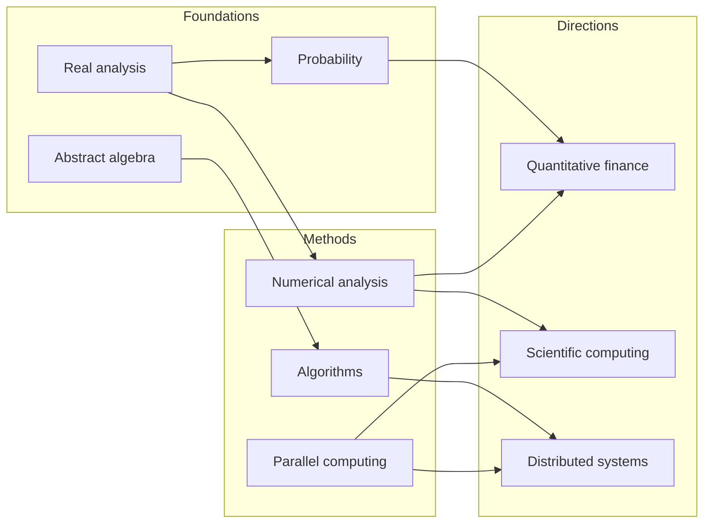

# Dobromir Iliev

Mathematics & Computing at Georgia Tech. I like working on problems that require both mathematical reasoning and good software, particularly in scientific computing and systems.

[Email](mailto:dobromiriiliev@gmail.com) · [LinkedIn](https://www.linkedin.com/in/dobromir-iliev-1ba09b23b/)

## What I'm exploring

I'm currently studying **real analysis** and **abstract algebra**. Here's a rough map of where I want to take those foundations—not a checklist, just topics I keep coming back to.

A few things I'd like to understand better:

- **Quantitative finance:** stochastic processes, time series, and statistical modeling.
- **Distributed systems:** concurrency, fault tolerance, and systems that scale.
- **Scientific computing:** numerical simulation, parallel algorithms, and reproducible research.

## Selected work

**[Q-Scope](https://github.com/dobromiriiliev/qscope)**  
Bayesian experimental design for diagnosing drift in quantum systems. Built with Python and Qiskit.

**[Zebrafish-inspired propulsion](https://github.com/dobromiriiliev/An-Innovative-Energy-Efficient-Biomimetic-Propulsion-System-for-Submersibles-Derived-from-Zebrafish)**  
Research into bio-inspired underwater propulsion using computational modeling and simulation. [IEEE paper](https://ieeexplore.ieee.org/document/10947443).

## Open source

I'd be happy to collaborate on scientific computing projects, especially simulation tools, numerical software, and research infrastructure.

he/him 
