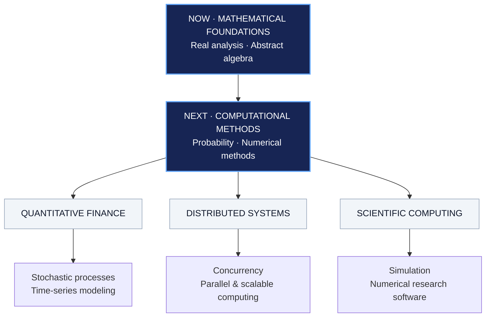

# Dobromir Iliev

**Mathematics & Computing · Georgia Tech**

I'm interested in the mathematics behind complex systems and the software that makes them useful. My work sits around scientific computing, computational modeling, and research engineering; I'm also exploring quantitative finance and distributed systems.

[Email](mailto:dobromiriiliev@gmail.com) · [LinkedIn](https://www.linkedin.com/in/dobromir-iliev-1ba09b23b/) · [Projects](#selected-work)

---

## Learning map

A small, evolving map of what I'm studying, what I want to understand next, and where I'd like to apply it.

<strong>01 / Mathematical foundations</strong> — studying now

- **Real analysis:** rigorous limits, continuity, differentiation, and convergence.
- **Abstract algebra:** groups, homomorphisms, and algebraic structure.
- **Next:** deeper probability and numerical analysis.

<strong>02 / Quantitative finance</strong> — exploring

- Stochastic processes and mathematical models of uncertainty.
- Time-series analysis and statistical learning.
- Simulation, optimization, and model validation.

<strong>03 / Distributed systems</strong> — exploring

- Concurrency and synchronization.
- Parallel algorithms and high-performance computing.
- Distributed coordination, fault tolerance, and scalability.

<strong>04 / Scientific computing</strong> — building and learning

- Numerical simulation and computational physics.
- Scientific machine learning and experiment design.
- Reproducible research software and open-source tooling.

---

## Selected work

**[Q-Scope](https://github.com/dobromiriiliev/qscope)** — An open-source quantum hardware diagnostic that uses Bayesian inference and adaptive experiment selection to localize and estimate Hamiltonian drift. Built with Qiskit.

**[Zebrafish-inspired biomimetic propulsion](https://github.com/dobromiriiliev/An-Innovative-Energy-Efficient-Biomimetic-Propulsion-System-for-Submersibles-Derived-from-Zebrafish)** — Research on energy-efficient underwater propulsion combining fluid dynamics, computational simulation, and neurologically inspired control. [IEEE publication](https://ieeexplore.ieee.org/document/10947443).

---

## Open source

I'd like to collaborate on projects involving **scientific computing, numerical software, simulation, and research infrastructure**. I'm especially interested in tools that make difficult computational problems easier to study and reproduce.

he/him 
