# Dobromir Iliev

**Mathematics & Computing · Georgia Institute of Technology**

Scientific Computing · Distributed Systems · Quantitative Finance

---

### About

I'm interested in the mathematical foundations of computing and their applications to complex systems. My work and interests span machine learning, scientific software, numerical methods, and distributed infrastructure.

I particularly enjoy problems that require both mathematical reasoning and efficient implementation.

Currently studying **real analysis** and **abstract algebra**, while exploring quantitative finance, high-performance computing, and distributed systems.

---

### Research & Technical Interests

```mermaid
flowchart TB
    CORE["MATHEMATICS × COMPUTING"]

    CORE --> MATH
    CORE --> QUANT
    CORE --> SYSTEMS
    CORE --> SCI

    subgraph FOUNDATION["01 / MATHEMATICAL FOUNDATIONS"]
        direction TB
        MATH["Mathematics"]
        M1["Real Analysis"]
        M2["Abstract Algebra"]
        M3["Probability & Statistics"]
        M4["Numerical Analysis"]
        MATH --> M1
        MATH --> M2
        MATH --> M3
        MATH --> M4
    end

    subgraph FINANCE["02 / QUANTITATIVE FINANCE"]
        direction TB
        QUANT["Quantitative Research"]
        Q1["Stochastic Processes"]
        Q2["Time-Series Modeling"]
        Q3["Statistical Learning"]
        Q4["Optimization & Simulation"]
        QUANT --> Q1
        QUANT --> Q2
        QUANT --> Q3
        QUANT --> Q4
    end

    subgraph INFRA["03 / DISTRIBUTED SYSTEMS"]
        direction TB
        SYSTEMS["Systems Engineering"]
        D1["Parallel Computing"]
        D2["Distributed Algorithms"]
        D3["High-Performance Computing"]
        D4["Scalable Infrastructure"]
        SYSTEMS --> D1
        SYSTEMS --> D2
        SYSTEMS --> D3
        SYSTEMS --> D4
    end

    subgraph RESEARCH["04 / SCIENTIFIC COMPUTING"]
        direction TB
        SCI["Computational Science"]
        S1["Numerical Simulation"]
        S2["Scientific Machine Learning"]
        S3["Computational Physics"]
        S4["Reproducible Research"]
        SCI --> S1
        SCI --> S2
        SCI --> S3
        SCI --> S4
    end

    classDef core fill:#0f172a,stroke:#38bdf8,stroke-width:2px,color:#ffffff
    classDef math fill:#1e3a5f,stroke:#60a5fa,stroke-width:2px,color:#ffffff
    classDef quant fill:#164e63,stroke:#22d3ee,stroke-width:2px,color:#ffffff
    classDef systems fill:#134e4a,stroke:#2dd4bf,stroke-width:2px,color:#ffffff
    classDef science fill:#312e81,stroke:#a5b4fc,stroke-width:2px,color:#ffffff
    classDef leaf fill:#f1f5f9,stroke:#cbd5e1,color:#0f172a

    class CORE core
    class MATH math
    class QUANT quant
    class SYSTEMS systems
    class SCI science
    class M1,M2,M3,M4,Q1,Q2,Q3,Q4,D1,D2,D3,D4,S1,S2,S3,S4 leaf

    style FOUNDATION fill:transparent,stroke:#60a5fa,stroke-width:1px
    style FINANCE fill:transparent,stroke:#22d3ee,stroke-width:1px
    style INFRA fill:transparent,stroke:#2dd4bf,stroke-width:1px
    style RESEARCH fill:transparent,stroke:#a5b4fc,stroke-width:1px
```

Areas of interest and ongoing study — not an exhaustive list of expertise.

---

### Selected Work

**[Q-Scope](https://github.com/dobromiriiliev/qscope)**  
*Adaptive Quantum Hardware Diagnostics*

An open-source framework for identifying Hamiltonian parameter drift through Bayesian experimental design. Combines particle-based inference, information-gain optimization, and quantum simulation to adaptively select informative experiments.

`Python` `Qiskit` `Bayesian Inference` `Optimization`

**[Zebrafish Biomimetic Propulsion](https://github.com/dobromiriiliev/An-Innovative-Energy-Efficient-Biomimetic-Propulsion-System-for-Submersibles-Derived-from-Zebrafish)**  
*Research in Bio-Inspired Underwater Systems*

Research into energy-efficient underwater propulsion inspired by zebrafish locomotion, combining computational modeling, robotics, and simulation.

[IEEE Publication](https://ieeexplore.ieee.org/document/10947443)

`Robotics` `Simulation` `Computational Modeling` `Research`

---

### What I'm Learning

| Area | Topics |
| :--- | :--- |
| Mathematics | Real Analysis, Abstract Algebra |
| Quantitative Finance | Stochastic Modeling, Time-Series Analysis |
| Distributed Systems | Parallel Algorithms, Scalable Computing |
| Scientific Computing | Numerical Methods, Simulation, Optimization |

---

### Open Source & Collaboration

I'm interested in contributing to open-source projects involving:

- Scientific computing and numerical software
- Distributed and high-performance computing
- Mathematical modeling and simulation
- Research tools and reproducible computational workflows

I'm especially drawn to projects that connect theoretical ideas with practical implementations.

---

### Elsewhere

**Email:** [dobromiriiliev@gmail.com](mailto:dobromiriiliev@gmail.com)  
**LinkedIn:** [linkedin.com/in/dobromir-iliev-1ba09b23b](https://www.linkedin.com/in/dobromir-iliev-1ba09b23b/)

he/him 

---
