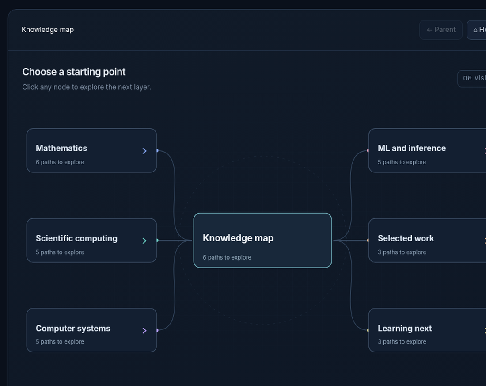

# Dobromir Iliev

Mathematics & Computing at Georgia Tech.

I work on problems where mathematics, computing, and physics overlap. I've spent most of my time on research software, simulation, machine learning, and systems. Lately I'm interested in understanding distributed systems and quantitative finance more deeply.

[LinkedIn](https://www.linkedin.com/in/dobromir-iliev-1ba09b23b/) · [Email](mailto:dobromiriiliev@gmail.com)

## Knowledge map

A collection of subjects I've studied and the projects they've led to. Pick a branch to explore; the full version opens as an interactive site.

**[Open interactive map ↗](https://dobromiriiliev.github.io/dobromiriiliev/)**

<strong>Browse the map here on GitHub</strong> (no separate site needed)

 

Mathematics

- Linear algebra, multivariable calculus, and differential equations
- Probability, statistics, combinatorics, and proofs
- Real analysis and abstract algebra (currently studying)

Scientific computing

- Numerical methods, Monte Carlo simulation, and reproducibility
- HPC: Linux, Slurm, GPU/CPU workflows
- Physics simulation, computational fluid dynamics, and visualization
- Work at Sandia National Laboratories, GTRI, and NVIDIA AI Makerspace

Computer systems

- Computer architecture, compilers, Linux, and POSIX
- Concurrency, sockets, distributed storage, replication, fault tolerance
- Projects: Helix Compiler, AtlasFS, RelayIPC

Machine learning and inference

- Segmentation and classification: U-Net, DenseNet
- Bayesian updating, experiment design, and information gain
- Vector search: FAISS, Qdrant; REST services and data validation
- Work at IBM Granite, Emory, and Georgia Tech's Rahnev Lab

Projects and research

- [Q-Scope](https://github.com/dobromiriiliev/qscope) — adaptive Bayesian diagnostics for quantum Hamiltonian drift
- [Zebrafish-inspired propulsion](https://github.com/dobromiriiliev/An-Innovative-Energy-Efficient-Biomimetic-Propulsion-System-for-Submersibles-Derived-from-Zebrafish) — computational modeling and bio-inspired underwater control ([IEEE paper](https://ieeexplore.ieee.org/document/10947443))
- [1554 Visual Companion](https://github.com/dobromiriiliev/1554-Visual-Companion) — visual linear algebra explanations with Manim
- Helix Compiler, AtlasFS, and RelayIPC

Still exploring

- Quantitative finance — stochastic processes and financial time series
- Distributed systems — consistency, coordination, and fault tolerance
- Scientific software — numerical methods and reproducible research

## Selected projects

**[Q-Scope](https://github.com/dobromiriiliev/qscope)** — Quantum hardware drift diagnostics using Bayesian experimental design and Qiskit.

**[Zebrafish-inspired propulsion](https://github.com/dobromiriiliev/An-Innovative-Energy-Efficient-Biomimetic-Propulsion-System-for-Submersibles-Derived-from-Zebrafish)** — Research on computational modeling and bio-inspired underwater propulsion. [IEEE paper](https://ieeexplore.ieee.org/document/10947443).

I'm open to collaborating on open-source numerical software, simulation tools, and research infrastructure.

he/him · ambidextrous
