# Dobromir Iliev

Mathematics & Computing at Georgia Tech.

I enjoy problems that sit between mathematics, computer science, and physics. Most of my work has involved scientific computing, machine learning, and systems engineering.

I'm currently studying **real analysis** and **abstract algebra**, and I'd like to explore quantitative finance and distributed systems more deeply.

[Email](mailto:dobromiriiliev@gmail.com) · [LinkedIn](https://www.linkedin.com/in/dobromir-iliev-1ba09b23b/)

---

## Knowledge map

A map of the subjects I've studied, the tools I've worked with, and the projects and research they've led to.

Solid lines show technical relationships. Dashed lines show areas I'm interested in exploring further.

```mermaid
flowchart TB
    HOME["Mathematics + Computing"]

    subgraph FOUNDATION["Mathematical and computational foundations"]
        direction TB

        MATH["Mathematics"]
        MATH --> LINEAR["Linear algebra"]
        MATH --> ODE["Differential equations"]
        MATH --> PROB["Probability and statistics"]
        MATH --> COMB["Combinatorics"]
        MATH --> REAL["Real analysis"]
        MATH --> ALGEBRA["Abstract algebra"]

        CS["Computer science"]
        CS --> DSA["Data structures and algorithms"]
        CS --> ORG["Computer organization / LC-3"]
        CS --> PROOFS["Discrete math and proofs"]
        CS --> LANG["C / C++ / Python"]

        PHYS["Physics"]
        PHYS --> MECH["Mechanics and electromagnetism"]
        PHYS --> PHYMODELS["Physical modeling"]
    end

    subgraph METHODS["Methods and tools"]
        direction TB

        NUM["Numerical computing"]
        NUM --> SIM["Simulation / Monte Carlo"]
        NUM --> NUMPY["NumPy / SciPy / MATLAB"]
        NUM --> CFD["Computational fluid dynamics"]

        INFER["Statistical inference"]
        INFER --> BAYES["Bayesian updating"]
        INFER --> EIG["Expected information gain"]
        INFER --> TIMESERIES["Forecasting and time series"]

        ML["Machine learning"]
        ML --> SEG["U-Net segmentation"]
        ML --> CLASS["DenseNet classification"]
        ML --> RETRIEVAL["Embeddings / vector search"]

        SYSTEMS["Systems engineering"]
        SYSTEMS --> POSIX["Linux / POSIX / IPC"]
        SYSTEMS --> NETWORK["TCP/IP / socket programming"]
        SYSTEMS --> DIST["Replication / failure recovery"]
        SYSTEMS --> COMPILER["Compilers / optimization"]
        SYSTEMS --> HPC["Slurm / CPU-GPU clusters"]
        SYSTEMS --> TESTS["Docker / CI / performance tests"]
    end

    subgraph EXPERIENCE["Research and engineering"]
        direction TB

        SANDIA["Sandia National Laboratories"]
        SANDIA --> SANDIA1["Random-number reproducibility"]
        SANDIA --> SANDIA2["Linux HPC automation"]

        EMORY["Emory University"]
        EMORY --> EMORY1["Computational pathology"]
        EMORY --> EMORY2["QuPath / paquo workflows"]

        IBM["IBM Granite"]
        IBM --> IBM1["REST APIs / dataset validation"]
        IBM --> IBM2["FAISS / Qdrant retrieval"]

        RAHNEV["Georgia Tech - Rahnev Lab"]
        RAHNEV --> RAHNEV1["fMRI and BCI research"]
        RAHNEV --> RAHNEV2["Deep-learning segmentation"]

        GTRI["Georgia Tech Research Institute"]
        GTRI --> GTRI1["Radar simulation / verification"]
        GTRI --> GTRI2["GitLab CI / performance testing"]

        VIP["NVIDIA AI Makerspace"]
        VIP --> VIP1["GPU / CPU batch workflows"]

        TA["Georgia Tech - Physics TA"]
        TA --> TA1["Mechanics / electromagnetism"]
    end

    subgraph PROJECTS["Projects and publications"]
        direction TB

        QSCOPE["Q-Scope"]
        QSCOPE --> QS1["Transverse-field Ising model"]
        QSCOPE --> QS2["Bayesian posterior / Qiskit"]
        QSCOPE --> QS3["Active localization and calibration"]

        ZEBRA["Zebrafish - IEEE publication"]
        ZEBRA --> Z1["Computational fluid dynamics"]
        ZEBRA --> Z2["Neurological / probabilistic modeling"]
        ZEBRA --> Z3["ROS-based propulsion control"]

        HELIX["Helix Compiler"]
        HELIX --> H1["Lexer / parser / AST / IR"]
        HELIX --> H2["Compiler optimization"]

        ATLAS["AtlasFS"]
        ATLAS --> A1["Distributed storage / TCP"]
        ATLAS --> A2["Replication / failure recovery"]

        RELAY["RelayIPC"]
        RELAY --> R1["Processes / pipes / shared memory"]
        RELAY --> R2["Semaphores / descriptor lifecycle"]

        VISUAL["1554 Visual Companion"]
        VISUAL --> V1["Manim / linear algebra visualizations"]
    end

    subgraph EXPLORING["Where I want to go next"]
        direction TB

        QUANT["Quantitative finance"]
        QUANT --> Q1["Stochastic processes"]
        QUANT --> Q2["Time-series modeling"]
        QUANT --> Q3["Statistical arbitrage"]

        DEEPDIST["Distributed systems"]
        DEEPDIST --> D1["Consistency models"]
        DEEPDIST --> D2["Fault-tolerant infrastructure"]
        DEEPDIST --> D3["Distributed algorithms"]

        REPRO["Scientific software"]
        REPRO --> RP1["Numerical algorithms"]
        REPRO --> RP2["Reproducible experiments"]
        REPRO --> RP3["High-performance simulation"]
    end

    HOME --> MATH
    HOME --> CS
    HOME --> PHYS

    MATH ==> NUM
    MATH ==> INFER
    CS ==> ML
    CS ==> SYSTEMS
    PHYS ==> NUM

    PHYS --> TA
    MATH --> VISUAL

    NUM --> SANDIA
    NUM --> GTRI
    NUM --> VIP

    ML --> EMORY
    ML --> RAHNEV
    ML --> IBM

    SYSTEMS --> GTRI
    SYSTEMS --> VIP

    INFER --> QSCOPE
    INFER --> ZEBRA
    NUM --> ZEBRA

    SYSTEMS --> HELIX
    SYSTEMS --> ATLAS
    SYSTEMS --> RELAY

    INFER -.-> QUANT
    SYSTEMS -.-> DEEPDIST
    NUM -.-> REPRO

    classDef core fill:#17253b,stroke:#6c8db2,color:#ffffff,stroke-width:1.5px;
    classDef topic fill:#e8edf3,stroke:#a3b2c4,color:#263749;
    classDef experience fill:#e2efe9,stroke:#88b5a1,color:#244c3f;
    classDef project fill:#e9e8f5,stroke:#aaa5cf,color:#39365c;
    classDef future fill:#fff4df,stroke:#d1b878,color:#6b5327;

    class HOME,MATH,CS,PHYS,NUM,INFER,ML,SYSTEMS core;
    class SANDIA,EMORY,IBM,RAHNEV,GTRI,VIP,TA experience;
    class QSCOPE,ZEBRA,HELIX,ATLAS,RELAY,VISUAL project;
    class QUANT,DEEPDIST,REPRO future;
```

---

## Selected work

### [Q-Scope](https://github.com/dobromiriiliev/qscope)

A Bayesian experimental design framework for diagnosing Hamiltonian drift in quantum systems.

Built using Python, Qiskit, NumPy, and SciPy. The system adaptively selects experiments based on expected information gain and updates a posterior distribution over possible drift parameters.

### [Zebrafish-inspired biomimetic propulsion](https://github.com/dobromiriiliev/An-Innovative-Energy-Efficient-Biomimetic-Propulsion-System-for-Submersibles-Derived-from-Zebrafish)

Research into underwater propulsion inspired by zebrafish locomotion and neurological control.

Combines computational fluid dynamics, probabilistic modeling, and robotics.

[IEEE publication](https://ieeexplore.ieee.org/document/10947443)

### Systems projects

- **Helix Compiler** — Lexical analysis, parsing, intermediate representation, and optimization.
- **AtlasFS** — Distributed file storage with replication and failure recovery.
- **RelayIPC** — Process communication using POSIX primitives.
- **[1554 Visual Companion](https://github.com/dobromiriiliev/1554-Visual-Companion)** — Visual explanations of linear algebra using Manim.

---

## Research and experience

| Organization | Focus |
| :--- | :--- |
| Georgia Tech Research Institute | Radar systems modeling and verification |
| IBM Granite | Machine learning infrastructure and retrieval |
| Sandia National Laboratories | HPC, reproducibility, and scientific software |
| Emory University | Computational pathology and deep learning |
| Georgia Tech Rahnev Lab | fMRI analysis and brain-computer interfaces |
| NVIDIA AI Makerspace | GPU computing and HPC workflows |
| Georgia Tech | Teaching assistant, Physics I and II |

---

## Currently learning

**Mathematics:** Real analysis, abstract algebra, probability theory.

**Systems:** Distributed algorithms, concurrency, high-performance computing.

**Quantitative finance:** Stochastic processes, financial time series, and mathematical modeling.

**Scientific computing:** Numerical methods, simulation, and reproducible research.

---

## Open source

I'm interested in collaborating on open-source projects involving scientific computing, numerical software, distributed systems, and research infrastructure.

If you're working on something interesting in these areas, feel free to reach out.

---

[Email](mailto:dobromiriiliev@gmail.com) · [LinkedIn](https://www.linkedin.com/in/dobromir-iliev-1ba09b23b/)

he/him · Ambidextrous
