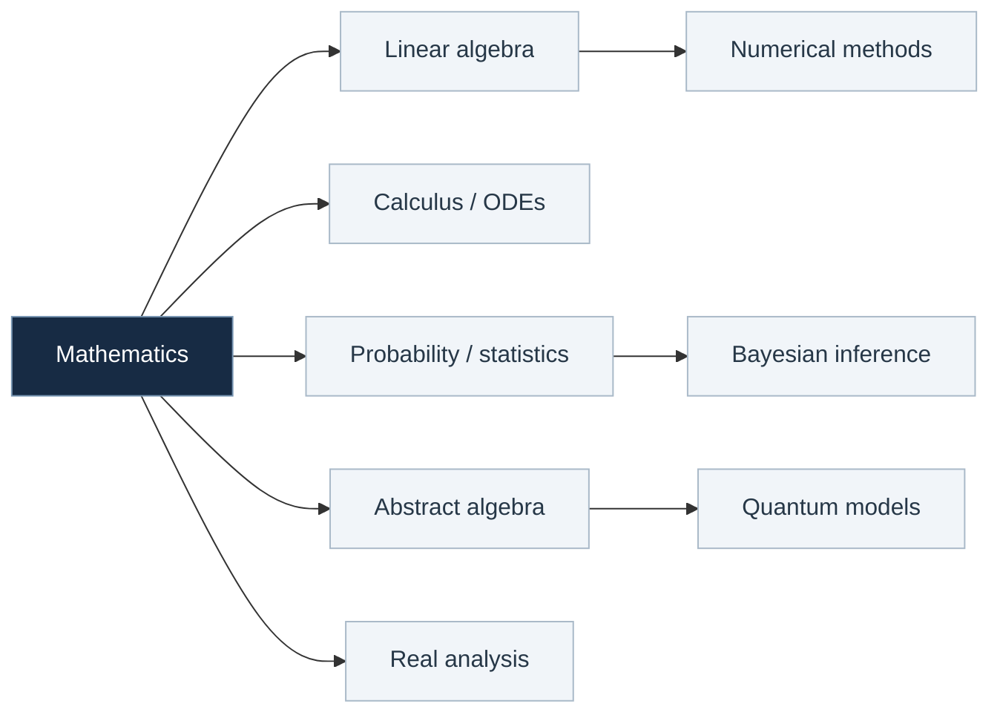
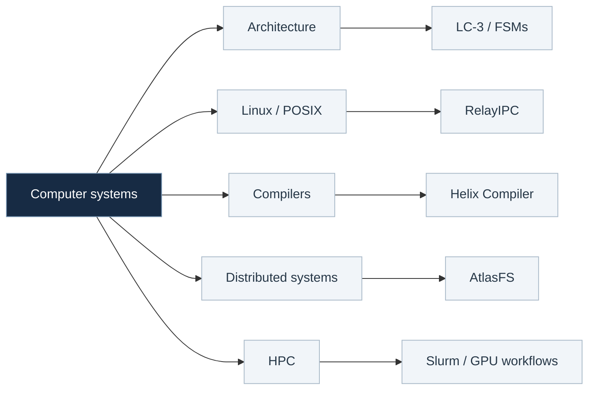
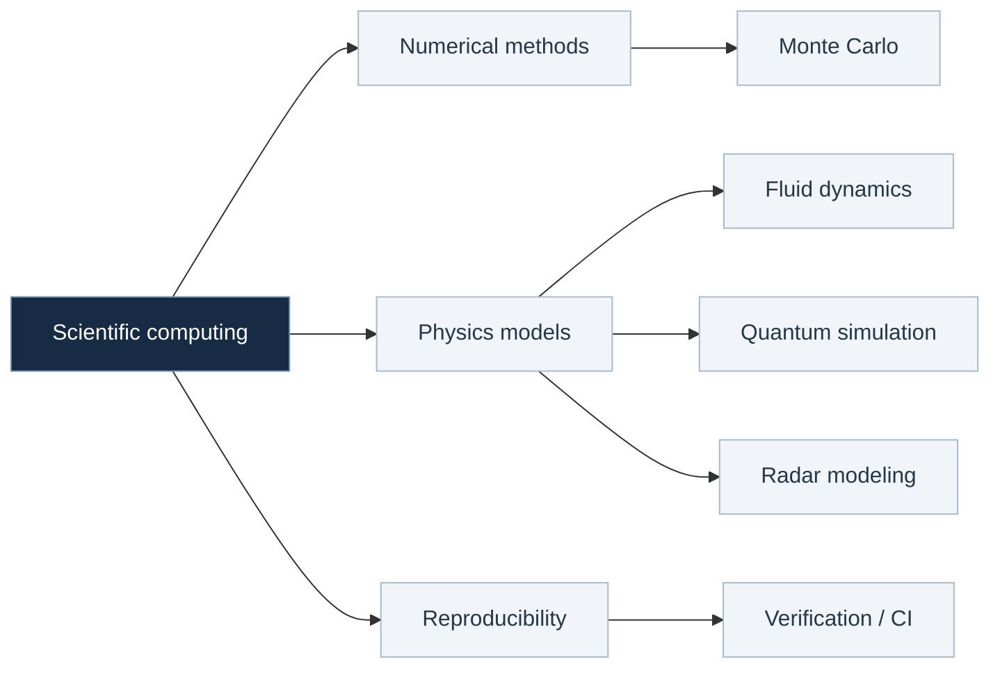
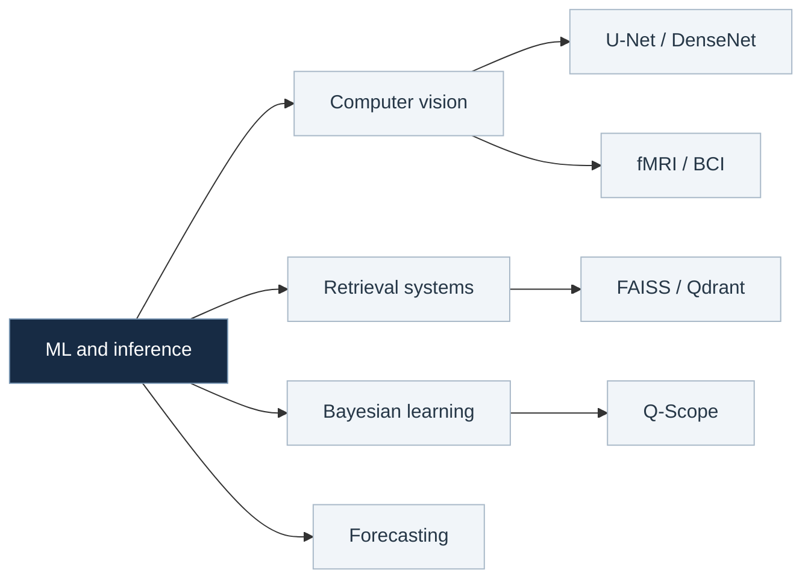

# Dobromir Iliev

Mathematics & Computing at Georgia Tech.

I'm interested in scientific computing, systems, and the mathematics behind them. I've worked on everything from quantum simulation and computational pathology to distributed storage and HPC. Right now I'm studying real analysis and abstract algebra, and I'm curious about quantitative finance.

[Email](mailto:dobromiriiliev@gmail.com) · [LinkedIn](https://www.linkedin.com/in/dobromir-iliev-1ba09b23b/)

---

## A map of what I've worked on

This is meant to be explored rather than read top to bottom. Open a branch to see how the subjects connect; open a subtopic for more detail. Everything expands **on this page**.

<strong>01 · Mathematics</strong> — foundations, probability, and algebra

Linear algebra and applied mathematics

- Vector spaces, eigenvalues, linear transformations, and matrix methods.
- Multivariable calculus, differential equations, and dynamical models.
- [1554 Visual Companion](https://github.com/dobromiriiliev/1554-Visual-Companion): Manim-based visualizations of linear algebra concepts.

Probability, statistics, and inference

- Conditional probability, independence, random variables, and discrete distributions.
- Monte Carlo experiments, random-number reproducibility, and stochastic variability.
- Bayesian inference, posterior updates, and information-gain optimization in Q-Scope.

Proofs and algebra

- Proof techniques, induction, modular arithmetic, and combinatorics.
- Group actions, stabilizers, conjugacy, homomorphisms, Burnside's lemma, and Sylow's theorems.
- Currently learning: real analysis and abstract algebra.

<strong>02 · Computer systems</strong> — architecture, compilers, concurrency, distributed software

Computer architecture and low-level programming

- Digital logic, state machines, sequential circuits, memory, and the LC-3 ISA.
- C, C++, Python, Unix tooling, and debugging.

Compilers and operating systems

- **Helix Compiler:** lexing, parsing, ASTs, symbol tables, intermediate representation, control-flow lowering, and optimization.
- **RelayIPC:** `fork`, `exec`, pipes, shared memory, semaphores, Unix-domain sockets, and resource cleanup.

Distributed systems and high-performance computing

- **AtlasFS:** chunked storage, metadata management, TCP message framing, replication, heartbeats, and replica recovery.
- **NVIDIA AI Makerspace / GT VIP:** Linux GPU/CPU batch workflows with Slurm.
- **Sandia:** scientific computing workflows and reproducibility across Linux HPC environments.

<strong>03 · Scientific computing & physics</strong> — simulation, numerical experiments, quantum systems

Numerical experiments and reproducibility

- Monte Carlo simulation, deterministic random-number generation, and CPU/GPU workflow reproducibility at Sandia.
- Performance measurement, regression tests, and numerical variability checks at GTRI.
- Linux, Python, Bash, NumPy, SciPy, and scientific batch computing.

Computational physics and quantum systems

- [Q-Scope](https://github.com/dobromiriiliev/qscope): transverse-field Ising model, finite-shot simulation, particle posteriors, and expected information gain.
- [Zebrafish propulsion](https://github.com/dobromiriiliev/An-Innovative-Energy-Efficient-Biomimetic-Propulsion-System-for-Submersibles-Derived-from-Zebrafish): computational modeling of bio-inspired underwater propulsion; [IEEE publication](https://ieeexplore.ieee.org/document/10947443).
- Physics I/II teaching: mechanics and electromagnetism.

<strong>04 · Machine learning & inference</strong> — images, retrieval, adaptive experiments

Image analysis and neuroscience

- **Emory:** U-Net segmentation and DenseNet classification for computational pathology; QuPath and paquo automation.
- **Rahnev Lab:** deep-learning methods applied to fMRI analysis and noninvasive brain-computer interface research.

Data, retrieval, and active learning

- **IBM Granite:** data validation, REST APIs, retrieval pipelines, FAISS, Qdrant, and reproducible deployment tooling.
- **Q-Scope:** particle-based posterior inference, experiment selection, and adaptive calibration of quantum models.
- Forecasting pipelines, statistical modeling, and benchmarking.

<strong>05 · Research & projects</strong> — where I've applied these ideas

Research and engineering

- **Sandia National Laboratories:** HPC automation and random-number reproducibility.
- **Emory University:** computational pathology and medical image analysis.
- **IBM Granite:** machine-learning infrastructure, retrieval, and forecasting.
- **Georgia Tech Rahnev Lab:** fMRI and BCI research.
- **Georgia Tech Research Institute:** radar simulation, testing, and numerical verification.
- **NVIDIA AI Makerspace:** GPU and CPU computing on Linux clusters.
- **Georgia Tech:** teaching assistant for mechanics and electromagnetism.

Open-source and personal projects

- **[Q-Scope](https://github.com/dobromiriiliev/qscope):** active Bayesian diagnostics for Hamiltonian drift.
- **[Zebrafish-inspired propulsion](https://github.com/dobromiriiliev/An-Innovative-Energy-Efficient-Biomimetic-Propulsion-System-for-Submersibles-Derived-from-Zebrafish):** biologically inspired underwater propulsion. [IEEE paper](https://ieeexplore.ieee.org/document/10947443).
- **Helix Compiler:** multi-stage compiler and optimization passes.
- **AtlasFS:** distributed file storage, replication, and failure recovery.
- **RelayIPC:** multiprocess communications with POSIX primitives.
- **[1554 Visual Companion](https://github.com/dobromiriiliev/1554-Visual-Companion):** linear algebra visualizations with Manim.

<strong>06 · Learning next</strong> — quantitative finance, systems, scientific software

- **Quantitative finance:** stochastic processes, time-series analysis, numerical optimization, and statistical models.
- **Distributed systems:** consistency, concurrency, fault tolerance, and scalable infrastructure.
- **Scientific software:** higher-performance numerical algorithms, reproducible experiments, and simulation frameworks.

These are directions I'm exploring, rather than claims of prior expertise.

---

## Selected work

**[Q-Scope](https://github.com/dobromiriiliev/qscope)** — Bayesian experiment selection for diagnosing drift in quantum systems, built with Qiskit.

**[Zebrafish-inspired biomimetic propulsion](https://github.com/dobromiriiliev/An-Innovative-Energy-Efficient-Biomimetic-Propulsion-System-for-Submersibles-Derived-from-Zebrafish)** — computational approaches to bio-inspired underwater propulsion. [IEEE paper](https://ieeexplore.ieee.org/document/10947443).

I'm interested in collaborating on open-source scientific computing, numerical software, and research infrastructure.

he/him · ambidextrous
